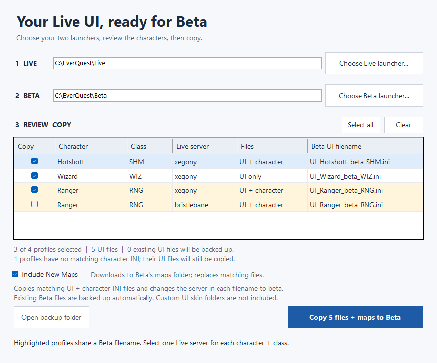

# EverQuest Beta UI Copier

A small Windows utility that copies your Live EverQuest character UI settings to Beta, updates the filenames automatically, and can download the latest map files.

Share just **EverQuest-Beta-UI-Copier.exe**. There is no installer. An internet connection is needed only when **Include New Maps** is checked. The application uses the .NET Framework included with Windows 10/11; it must be enabled on the machine.



## Download

Download `EverQuest-Beta-UI-Copier.exe` from this repository's **Releases** when a release is available. If you download the portable ZIP, extract the executable first. Developers can also build it using the instructions below.

## Use

1. Double-click `EverQuest-Beta-UI-Copier.exe`.
2. Click **Choose Live launcher** and select your **Live EverQuest desktop shortcut**, or `LaunchPad.exe` / `eqgame.exe` in the Live installation.
3. Click **Choose Beta launcher** and select the corresponding **Beta shortcut or launcher**.
4. Review the selected characters/classes. Leave **Include New Maps** checked to download the current maps, or uncheck it to copy only UI settings.
5. Click **Copy to Beta**.

You can keep Live running while copying saved settings to Beta. The utility does not block copying based on running EverQuest processes.

The folder paths and target filenames are shown before copying. Make sure Live and Beta are assigned correctly; their launcher executables have the same name. Nothing is copied until you click Copy. The program reads shortcut targets without running them.

## Files copied

The program finds `UI_<character>_<server>_<class>.ini` in the Live game folder, then looks for the matching `<character>_<server>_<class>.ini`. It copies the UI file even when the companion is missing. All recognized class codes and any alphanumeric Live server name are supported, case-insensitively.

For example:

```text
UI_Hotshott_xegony_SHM.ini  ->  UI_Hotshott_beta_SHM.ini
Hotshott_xegony_SHM.ini     ->  Hotshott_beta_SHM.ini
```

Only the filename's server component changes. File contents and Live originals remain unchanged. Files already named for `beta`, old files without a class suffix, extra-suffix files such as `_shrd.ini`, unmatched character files, and unrelated files are ignored. Custom `uifiles` skin folders are outside this utility's scope and must already exist on Beta if the selected UI requires one.

If the same character/class exists on multiple Live servers, those rows are highlighted and initially unchecked. Select only one server for each conflicting character/class.

## Include New Maps

This checkbox starts checked. When you click Copy, the utility downloads the latest `main` branch archive from [Ewiclip/Beta-UI-Copier](https://github.com/Ewiclip/Beta-UI-Copier) and uses only the `.txt` files directly inside its [maps folder](https://github.com/Ewiclip/Beta-UI-Copier/tree/main/maps).

UI and character INIs stay in the **Beta EverQuest root folder**. Downloaded maps go in **that same Beta folder's `maps` subfolder**, which is created if needed. Matching map files are replaced, with their previous versions backed up. Other existing map files are left alone. The Live installation is not changed.

The entire map download is checked before changing any Beta files. If the download fails, nothing is copied; retry or uncheck **Include New Maps** to copy UI settings offline. No network request is made when the option is unchecked. Map files are fetched at copy time, so publishing updates to the repository's `maps` folder does not require rebuilding the application.

## Backups and recovery

Before replacing any Beta files, the utility stages the selected source files and downloaded maps, then backs up every existing target in a uniquely named folder below `BetaUI-Backups` in the Beta installation. Previous UI files are in that transfer's `originals` subfolder; previous maps are in `originals/maps`. A transfer manifest records the files. The **Open backup folder** button opens the latest successful transfer's folder.

If a copy fails, the utility attempts to restore all UI and map files it tried to change and reports any restoration failure. Backups are retained. To restore files manually, close Beta and copy the contents of `originals` into the Beta game folder, keeping the `maps` subfolder structure. Files that were newly created have no previous version to restore.

The utility runs with your normal Windows account. It does not automatically request administrator access; choose an installation you can write to. This is an unsigned, locally built application, so Windows may identify the publisher as unknown when it is shared.

## Build and test

Build on Windows with Windows PowerShell 5.1 or PowerShell 7 and the .NET Framework C# compiler. Visual Studio, the .NET SDK, and third-party packages are not required.

```powershell
# Build the portable application
powershell -NoProfile -File .\build.ps1

# Build, run the tests, and create a ZIP containing only the application
powershell -NoProfile -File .\build.ps1 -Test -Package
```

The application is written to `dist\EverQuest-Beta-UI-Copier.exe`. The `-Package` option also creates `dist\EverQuest-Beta-UI-Copier.zip`. Close a previously running copy of the copier if Windows prevents replacing that executable during a build.

Tests cover UI and map transfers, rollback, map archive validation, launcher shortcuts, and the form's selection behavior. Standard tests run offline using temporary fixtures and never touch installed game folders. The form is rendered offscreen for visual inspection. The hard-link safety test reports a skip when the environment forbids creating hard links. Distribute only the application executable or its portable ZIP; the test executables are not required.

## Repository layout

- `Program.cs`: Windows interface and copy workflow.
- `LauncherResolver.cs`: reads launcher and shortcut locations without launching the game.
- `TransferCore.cs`: file discovery, renaming, backups, and failure recovery.
- `MapDownloader.cs`: downloads and checks the GitHub map files.
- `maps/`: map text files published for the optional download.
- `*.Tests.cs`: standalone test programs with temporary fixtures.
- `app.manifest`: Windows application settings.
- `build.ps1`: builds the application, runs tests, and packages the download.
- `.github/workflows/build.yml`: Windows build and tests on pushes, pull requests, and manual runs.

The entire project is self-contained in this folder. Generated `dist/` and `test-work/` files are ignored by Git. The workflow saves the executable and example form previews as build artifacts; it does not publish a release.

## Preparing a release

1. Run `powershell -NoProfile -File .\build.ps1 -Test -Package`.
2. Update `AssemblyVersion` and `AssemblyFileVersion` in `Program.cs` when releasing a new version, then rebuild.
3. Commit the source files and create the matching version tag in your GitHub repository.
4. Create a GitHub Release and attach `dist\EverQuest-Beta-UI-Copier.exe` or `dist\EverQuest-Beta-UI-Copier.zip`.

Keep generated binaries in release downloads; `.gitignore` keeps them out of source commits. The current application version is `1.1.0`.

This is an independent utility, not an official EverQuest or Daybreak application.
